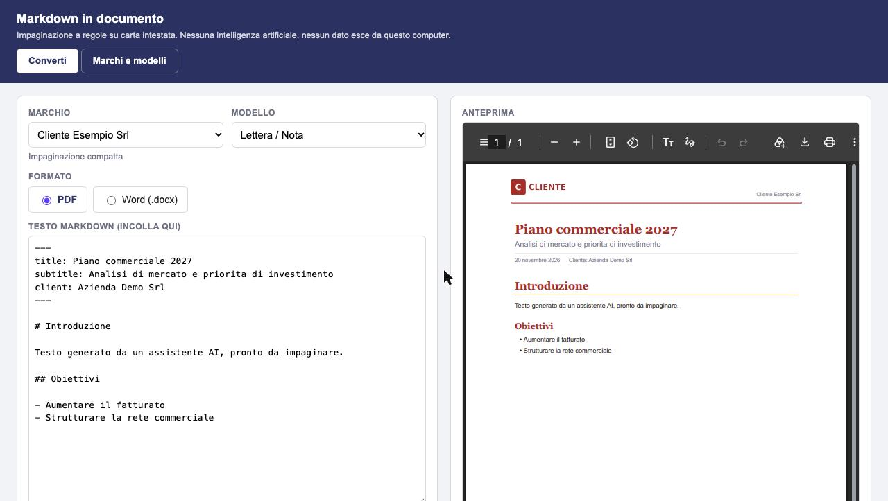

# MD in documento

Trasforma i file markdown (anche quelli generati da un'intelligenza artificiale) in PDF o Word su carta intestata. L'applicativo non usa intelligenza artificiale e non fa chiamate esterne: applica regole di impaginazione definite una volta sola.



## Avvio

- Windows: doppio clic su `avvia.bat`
- Mac o Linux: `./avvia.sh`

Alla prima esecuzione installa le librerie (serve Python 3.10 o superiore). Su Mac serve anche Pango per il PDF: `brew install pango`. Poi si apre `http://127.0.0.1:5055`: scegli marchio, modello e formato, incolla il markdown, scarica il file. Raggiungibile solo dal tuo computer.

### Icona su Mac

`./mac/crea-app.sh` crea "MD in documento.app" in `~/Applications`: doppio clic, parte il programma e si apre il browser (si trova anche con Spotlight). A ogni clic il programma viene riavviato, cosi' usa sempre il codice piu' recente. Se sposti la cartella del progetto, rilancia lo script. Per fermare il programma: `pkill -f app.py`. Il registro e' in `~/Library/Logs/md2doc.log`.

Da terminale: `python cli.py file.md --marchio mio-marchio --modello documento --formato pdf` (con `--elenco` mostra marchi e modelli).

## Test

```
.venv/bin/pip install pytest
.venv/bin/python -m pytest
```

I test generano PDF e Word per ogni elemento markdown (titoli, elenchi, tabelle, codice, citazioni, front matter) con tutti i modelli del marchio di esempio.

## Esempio

[`esempi/prova.md`](esempi/prova.md) e' un markdown di prova con tutti gli elementi supportati. [`esempi/prova.pdf`](esempi/prova.pdf) e' il risultato con il marchio fittizio di esempio e il logo generico (modello "proposta": copertina, indice, carta intestata, numeri di pagina). Per rigenerarlo:

```
python cli.py esempi/prova.md --marchio esempio-cliente --modello proposta --formato pdf
```

## Marchi e modelli

Nell'applicazione, scheda **Marchi e modelli**: si crea un marchio (partendo dalla copia di uno esistente), si modificano dati societari, logo, colori e font, si aggiungono, duplicano ed eliminano i modelli, e con "Salva e anteprima" si vede subito un PDF di prova. L'eliminazione di un marchio sposta la cartella in `templates/_eliminati/`, da dove si recupera. Il marchio di esempio e' un normale marchio: per i tuoi dati reali crea un nuovo marchio.

Sotto il cofano ogni marchio e' una cartella in `templates/` e si puo' modificare anche a mano:

```
templates/
  mio-marchio/
    brand.yaml     identita', colori, font, modelli
    logo.png
```

Dentro `brand.yaml`:

- `marchio`: nome, ragione sociale, indirizzo, P.IVA, C.F., REA (il footer si compone da qui, oppure scrivi `footer:` a mano)
- `colori`, `font`, `logo`, `logo_altezza_mm`
- `modelli`: uno o piu' modelli per marchio. Ogni modello puo' attivare la copertina, cambiare margini e dimensione del testo per PDF e Word, e perfino sovrascrivere colori e font del marchio.

## Intestazione opzionale nel markdown

In cima al file, tra due righe `---`: `title`, `subtitle`, `doc_type`, `date`, `client`, `author`, `version`. Senza `title` si usa il primo titolo di livello 1. Senza `date` si usa la data di oggi.

## Regole di conversione

- PDF e Word: titoli, elenchi annidati, tabelle (intestazione ripetuta nelle pagine successive), citazioni, codice, collegamenti, numero di pagina e carta intestata su ogni pagina.
- L'HTML grezzo dentro il markdown non viene eseguito. Nel PDF le immagini sono ammesse solo da indirizzi https o dalla cartella del marchio.

## Da sapere

- Logo, colori e dati in `esempio-cliente` sono fittizi: copia la cartella, poi sostituisci `logo.png` e i valori in `brand.yaml`. Le cartelle dei marchi reali restano fuori da Git: `.gitignore` esclude tutto in `templates/` tranne `esempio-cliente`.
- I font indicati devono essere installati sul computer che apre il file (Word) o che genera il PDF; altrimenti subentra un font di riserva.
- Sul PDF e' disponibile l'anteprima nel browser; Word si controlla aprendolo.

## Licenza

MIT, vedi il file `LICENSE`.
