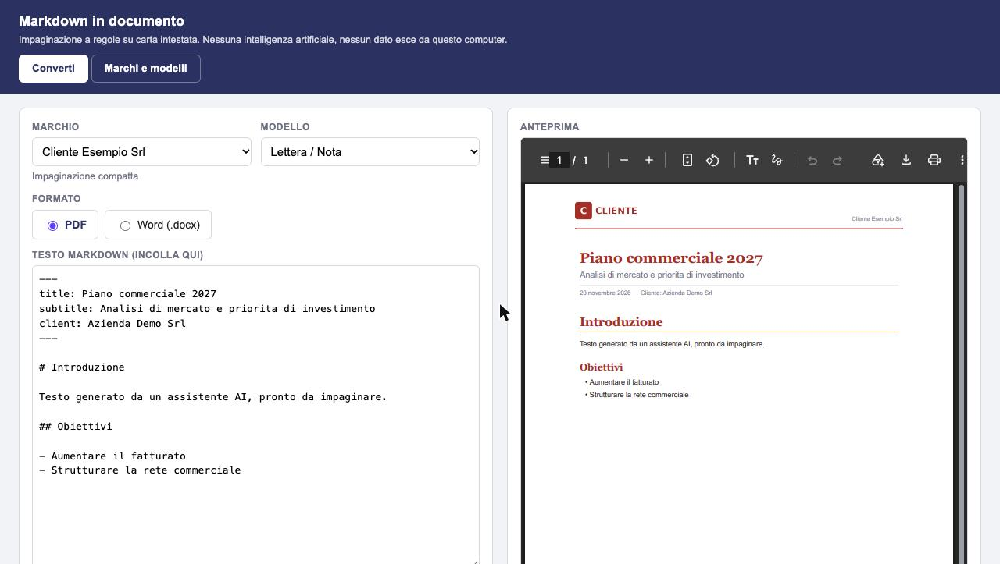

# md2doc

**Turn Markdown, including AI-generated Markdown, into corporate-formatted PDF and Word documents on your own letterhead.**

[Italiano](README.it.md)

md2doc is a local tool for two jobs:

- **Formatting AI output.** Reports, proposals and offers written by ChatGPT, Claude or any other assistant arrive as plain `.md`. md2doc applies your company's layout rules and gives you a finished document.
- **Building complex documents from `.md` files.** Cover page, table of contents, nested lists, tables with repeating headers, quotes, code, links, page numbers and letterhead on every page, from a single Markdown source.

It uses no AI and makes no external calls. Layout rules are defined once per brand and template, so the same input always produces the same output. The web interface is reachable only from your own computer (127.0.0.1).



## Features

- Output: **PDF** (WeasyPrint) and **Word .docx** (python-docx). PowerPoint is not offered for now: it needs a much more elaborate setup.
- **Brands and templates:** each brand is a folder with a `brand.yaml` and a logo. One brand can have several templates (for example "report" with a cover page, "letter" without). Colors, fonts, margins, text size and footer can be overridden per template.
- **Web interface** with a built-in editor for brands and templates and an instant PDF preview, plus a **command-line tool** using the same engine.
- **Optional YAML front matter** in the Markdown: `title`, `subtitle`, `doc_type`, `date`, `client`, `author`, `version`.
- **Safe by default:** raw HTML in Markdown is not executed, and PDF images are limited to https addresses and the brand folder.
- **Private brands stay private:** `.gitignore` excludes everything in `templates/` except the fictitious `esempio-cliente` brand.

## Quick start

Requires Python 3.10 or newer.

- Windows: double-click `avvia.bat`
- Mac or Linux: `./avvia.sh`

The first run installs the dependencies. On Mac, PDF output also needs Pango: `brew install pango`. Then open `http://127.0.0.1:5055`, choose brand, template and format, paste your Markdown and download the file.

Command line:

```
python cli.py file.md --marchio my-brand --modello documento --formato pdf
python cli.py --elenco     # list brands and templates
```

On Mac, `./mac/crea-app.sh` creates a double-click app in `~/Applications`.

## Example

[`esempi/prova.md`](esempi/prova.md) is a sample Markdown file with every supported element. [`esempi/prova.pdf`](esempi/prova.pdf) is the result with the fictitious example brand and generic logo (template "proposta": cover page, table of contents, letterhead, page numbers). Regenerate it with:

```
python cli.py esempi/prova.md --marchio esempio-cliente --modello proposta --formato pdf
```

## Create your own brand

In the **Marchi e modelli** tab, copy the example brand, then edit company data, logo, colors and fonts. Or copy `templates/esempio-cliente` by hand and edit `brand.yaml`. The logo, colors and company data in the example are fictitious.

Fonts named in a brand must be installed on the computer that opens the Word file, or generates the PDF; otherwise a fallback font is used.

## Tests

```
.venv/bin/pip install pytest
.venv/bin/python -m pytest
```

The tests generate PDF and Word for every Markdown element with all templates of the example brand.

## Limitations

- Word output has been checked visually through LibreOffice, not with Microsoft Word itself.
- The interface and documentation are in Italian; the README is available in both languages.

## License

MIT, see [LICENSE](LICENSE).
